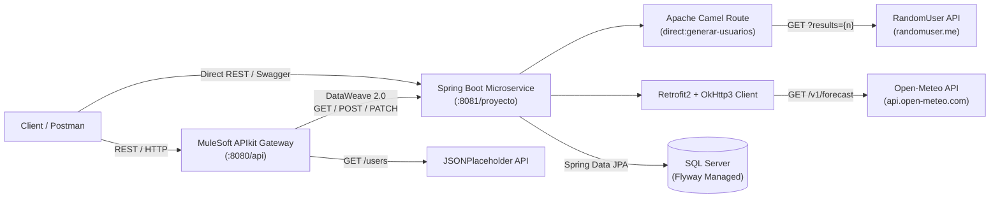

# 🌐 Data Integration Microservice — Spring Boot, Apache Camel & MuleSoft


An enterprise-style backend microservice built with **Java 21** and **Spring Boot 3.4.2** that orchestrates multi-source data integration, combining **Apache Camel** routing, **Retrofit2** HTTP clients, **MapStruct** object mapping, **SQL Server** persistence with **Flyway** schema migrations, and an API-led integration layer in **MuleSoft Anypoint Platform**.

---

## ✨ Key Capabilities

- **🔀 Apache Camel Integration Routes (`UsuariosRoutes`)**
  - Uses a declarative Camel route (`direct:generar-usuarios`) to consume external user profiles from the [RandomUser API](https://randomuser.me/api) with built-in exception handling and payload logging.
- **🌦️ Geospatial Weather Enrichment (`ClientRetrofit` & `RetrofitConfig`)**
  - Uses **Retrofit2** and **OkHttp3** (with custom header & body logging interceptors) to query real-time meteorological telemetry from the [Open-Meteo API](https://api.open-meteo.com/v1/forecast) for each generated user's latitude and longitude, persisting both user and weather entities into SQL Server.
- **⚡ Compile-Time Object Mapping (`MapStruct`)**
  - High-performance, type-safe conversions between external API responses, internal DTOs (`UsuarioDto`), and JPA entities (`Usuario`, `ApiWeather`).
- **🗄️ Versioned Database Migrations (`Flyway` + `SQL Server`)**
  - Automated relational schema management via versioned SQL scripts (`V1.1__createTable.sql`, `V1.2__addManualColumn.sql`), distinguishing between externally ingested users and manually registered records (`manual_flag`).
- **🔗 MuleSoft ESB / APIkit Layer (`Mulesoft/`)**
  - Includes an **OpenAPI 3.0** specification (`DesignCenter.yaml`) and a **Mule 4** application (`ProyectoIntegrador.xml`) featuring **DataWeave 2.0** transformations that expose a unified gateway on port `8080` and route traffic to the Spring Boot microservice (`:8081/proyecto`) and `JSONPlaceholder`.

---

## 🏗️ System Architecture



---

## 🛠️ Tech Stack

| Layer | Technology |
| :--- | :--- |
| **Language & Runtime** | Java 21 (LTS) |
| **Framework** | Spring Boot 3.4.2 (Web, Data JPA, Validation, JDBC) |
| **Integration & EAI** | Apache Camel 4.9.0 (`camel-spring-boot-starter`, `camel-http`, `camel-jackson`), MuleSoft 4 (APIkit, DataWeave 2.0) |
| **HTTP Client** | Retrofit 2.9.0, OkHttp 4.9.3 (`logging-interceptor`) |
| **Database & Migrations** | Microsoft SQL Server (`mssql-jdbc 12.8.0`), Flyway |
| **Mapping & Boilerplate** | MapStruct 1.5.5, Lombok, Jackson |
| **API Documentation** | SpringDoc OpenAPI 2.3.0 (Swagger UI), OpenAPI 3.0 YAML |
| **Build Tool & Testing** | Gradle 8.x, JUnit 5 |

---

## 📡 API Endpoints

Base URL: `http://localhost:8081/proyecto`

### 👤 Users Controller (`/Personas`)

| Method | Endpoint | Description |
| :--- | :--- | :--- |
| `POST` | `/Personas/GenerarPersonas/{cantidad}` | Triggers the Apache Camel route to fetch `{cantidad}` random users, enriches each user's coordinates with live weather data via Retrofit2, and persists all records in SQL Server (`manual_flag = false`). |
| `POST` | `/Personas/InsertarUsuario` | Creates a single user manually (`manual_flag = true`). |
| `GET` | `/Personas/BuscarUsuarioPorId/{id}` | Retrieves a user DTO by primary key ID. |
| `POST` | `/Personas/ActualizarUsuario` | Updates an existing user entity. |
| `PATCH` | `/Personas/ActualizarCorreo/{id}` | Updates a user's email address by ID. |

### 🌤️ Weather Controller (`/Clima`)

| Method | Endpoint | Description |
| :--- | :--- | :--- |
| `GET` | `/Clima/GetDatosClima?Latitud={lat}&Longitud={lon}` | Retrieves stored meteorological records by composite coordinate key (`Latitud`, `Longitud`). |

---

## 📁 Project Structure

```text
Microservicio-con-Integracion-de-Datos/
├── Mulesoft/
│   ├── DesignCenter.yaml                # OpenAPI 3.0 contract for MuleSoft APIkit
│   └── ProyectoIntegrador.xml           # Mule 4 flows & DataWeave 2.0 transformations
├── src/
│   ├── main/
│   │   ├── java/com/proyecto/springboot_api/
│   │   │   ├── client/                  # Retrofit2 declarative HTTP interface
│   │   │   ├── configurations/retrofit/ # OkHttp3 interceptors & Retrofit bean config
│   │   │   ├── controllers/             # REST controllers (Usuarios, Weather)
│   │   │   ├── embeddables/             # JPA @Embeddable models (Coordenadas, Login)
│   │   │   ├── mapper/                  # MapStruct mappers (UsuariosMapper, WeatherMapper)
│   │   │   ├── models/                  # JPA Entities, DTOs, and external API response models
│   │   │   ├── producers/               # Apache Camel ProducerTemplate integration
│   │   │   ├── repositories/            # Spring Data JPA repositories
│   │   │   ├── routes/                  # Apache Camel RouteBuilder definitions
│   │   │   └── services/                # Business logic & external API orchestration
│   │   └── resources/
│   │       ├── db/migration/            # Flyway SQL migrations (V1.1, V1.2)
│   │       ├── application.yml          # Environment-driven Spring configuration
│   │       └── application.yml.example  # Configuration template
│   └── test/                            # JUnit 5 test suite
└── build.gradle                         # Gradle build configuration
```

---

## 🚀 Getting Started

### Prerequisites

- **Java 21** or higher
- **Microsoft SQL Server** (Express, Developer, or Docker container)
- **Gradle 8.x** (or use the included `./gradlew` wrapper)

### 1. Clone the repository

```bash
git clone https://github.com/sarquis12/Microservicio-con-Integracion-de-Datos.git
cd Microservicio-con-Integracion-de-Datos
```

### 2. Create the SQL Server database

```sql
CREATE DATABASE ProyectoSpringV1;
```

### 3. Configure environment variables

The application reads database credentials from environment variables in `src/main/resources/application.yml`:

| Variable | Description | Example |
| :--- | :--- | :--- |
| `DB_URL` | JDBC connection string for SQL Server | `jdbc:sqlserver://localhost:1433;databaseName=ProyectoSpringV1;trustServerCertificate=true;encrypt=true` |
| `DB_USERNAME` | SQL Server username | `sa` |
| `DB_PASSWORD` | SQL Server password | `YourStrong!Passw0rd` |

Export them in your terminal before starting the service:

```bash
# Linux / macOS
export DB_URL="jdbc:sqlserver://localhost:1433;databaseName=ProyectoSpringV1;trustServerCertificate=true;encrypt=true"
export DB_USERNAME="sa"
export DB_PASSWORD="YourStrong!Passw0rd"

# Windows PowerShell
$env:DB_URL="jdbc:sqlserver://localhost:1433;databaseName=ProyectoSpringV1;trustServerCertificate=true;encrypt=true"
$env:DB_USERNAME="sa"
$env:DB_PASSWORD="YourStrong!Passw0rd"
```

### 4. Run the microservice

Flyway migrations (`V1.1__createTable.sql` and `V1.2__addManualColumn.sql`) execute automatically on startup.

```bash
./gradlew bootRun
```

Or build and run the executable JAR:

```bash
./gradlew build
java -jar build/libs/springboot-api-0.0.1-SNAPSHOT.jar
```

### 5. Explore the API Documentation (Swagger UI)

Once running, open Swagger UI in your browser:

```text
http://localhost:8081/proyecto/swagger-ui.html
```

---

## 👤 Author

**Elias Yusef Sarquis Boutros**
- [LinkedIn](https://www.linkedin.com/in/elias-yusef-sarquis-boutros)
- [GitHub](https://github.com/sarquis12)
